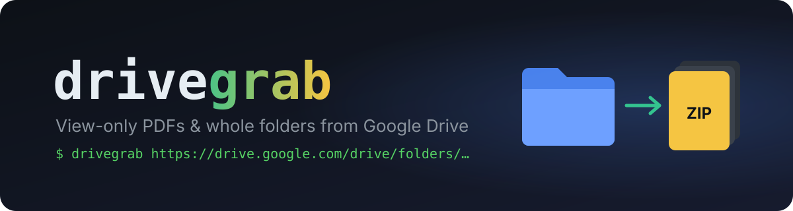

<p align="center">
  
</p>

<p align="center">
  
  
</p>

<p align="center"><a href="#english">English</a> · <a href="#русский">Русский</a></p>

---

## English

Some Google Drive files can only be **viewed**, not downloaded. There's no download button, and printing is blocked.
**drivegrab** saves them anyway. Paste a link, get the files.

- Works with a **single file** or a **whole folder** (all subfolders included).
- Keeps the **same folder structure** and packs it into a **.zip**.
- If a file *can* be downloaded normally, you get the original.

### How to use

**1. Download the project.** Click the green **Code** button, then **Download ZIP**, and unzip it. Or use git:

```bash
git clone https://github.com/Osmanov2006/drivegrab.git
```

**2. Install** (one time). You need [Python 3.9+](https://www.python.org/downloads/). Open a terminal in the project folder and run:

```bash
pip install -r requirements.txt
playwright install chromium
```

**3. Run it and paste a link**

```bash
python drivegrab.py
```

```text
Drive link (empty to quit): https://drive.google.com/drive/folders/...
```

A browser window opens and works by itself. **Don't close it.** When it's finished, your files are in the **`downloads`** folder.

### What you'll see

```text
folder: Probability and Random Variables
files found: 69

[1/69] Exercises/Chapter_1_Exercises_EN.pdf
    download is disabled, capturing the preview...
    pages: 12
    done: Chapter_1_Exercises_EN.pdf
...
zip: downloads/Probability and Random Variables.zip
```

- **download is disabled** means the file is view-only, so it gets rebuilt page by page. That's normal.
- **original file saved** means the file was downloadable, so you got the real one.

### Problems?

| Problem | Fix |
|---|---|
| It asks me to sign in | Sign in to Google in the opened browser window, then press Enter in the terminal. You only need to do this once. |
| Pages look blurry | `python drivegrab.py --size 2560x1440` |
| Can't select text in the PDF | View-only files are rebuilt from images. Use [OCRmyPDF](https://github.com/ocrmypdf/OCRmyPDF) if you need text. |
| Some files failed | They're listed at the end. Usually that's a video or a file with no preview. |

Other options: `-o folder` (save elsewhere), `--no-zip`, `-q 0.8` (smaller files). See `python drivegrab.py --help`.

### How it works

It opens Drive in a real browser (via [Playwright](https://playwright.dev/python/)). For folders, it reads Google's simple folder listing and goes into every subfolder. For each file it first tries a normal download. If that's blocked, it scrolls through the viewer, saves each page image as it appears, and joins them into a PDF with [img2pdf](https://pypi.org/project/img2pdf/).

---

## Русский

Некоторые файлы на Google Drive можно только **смотреть**: кнопки «Скачать» нет, печать закрыта.
**drivegrab** всё равно их сохраняет. Вставляешь ссылку и получаешь файлы.

- Работает с **одним файлом** или **целой папкой**, включая все подпапки.
- Сохраняет **ту же структуру папок** и упаковывает всё в **.zip**.
- Если файл можно скачать обычным способом, сохраняется оригинал.

### Как пользоваться

**1. Скачай проект.** Нажми зелёную кнопку **Code**, затем **Download ZIP**, и распакуй архив.

**2. Установи зависимости** (один раз). Нужен [Python 3.9+](https://www.python.org/downloads/). Открой терминал в папке проекта и выполни:

```bash
pip install -r requirements.txt
playwright install chromium
```

**3. Запусти и вставь ссылку**

```bash
python drivegrab.py
```

Откроется окно браузера и начнёт работать само. **Не закрывай его.** Когда всё закончится, файлы будут в папке **`downloads`**.

### Если что-то не так

| Проблема | Решение |
|---|---|
| Просит войти в аккаунт | Войди в Google в открывшемся окне и нажми Enter в терминале. Это нужно сделать один раз. |
| Страницы размытые | `python drivegrab.py --size 2560x1440` |
| В PDF не выделяется текст | View-only файлы собираются из картинок. Для текста используй [OCRmyPDF](https://github.com/ocrmypdf/OCRmyPDF). |
| Часть файлов не скачалась | Они перечислены в конце. Обычно это видео или файлы без превью. |

---

### Responsible use · Честное использование

drivegrab only works on files you can already open in your browser. It doesn't bypass access rights. Use it for material you're allowed to keep.
Скрипт работает только с файлами, которые ты и так можешь открыть, и права доступа не обходит.

Based on the console trick from [zeltox/Google-Drive-PDF-Downloader](https://github.com/zeltox/Google-Drive-PDF-Downloader).
License: [MIT](LICENSE) © Magamedkhan Osmanov
