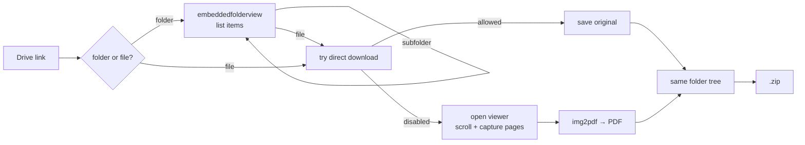

<p align="center">
  
</p>

<p align="center">
  <a href="https://github.com/Osmanov2006/drivegrab/actions/workflows/ci.yml"></a>
  
  
  
</p>

<p align="center"><b>English</b> · <a href="README.ru.md">Русский</a></p>

---

**drivegrab** downloads files from Google Drive, including the ones where the owner turned off downloading ("view-only"). Give it a link to a file or a whole folder. It walks every subfolder, saves each file into the same folder structure and packs the result into a `.zip`.

I built it because my university course materials (slides, lecture notes, past exams) are shared as view-only Drive folders with dozens of files across nested folders. Saving them one by one through the browser console took forever.

## Features

- **Whole folders, recursively.** Paste a folder link and get the full tree with the same paths, plus a zip.
- **View-only PDFs.** When downloading is disabled, it scrolls through the Drive viewer and rebuilds the PDF from the rendered pages.
- **Originals when possible.** Files that *can* be downloaded are saved as the original file, not as screenshots.
- **Handles long documents.** Drive unloads pages that scroll off-screen, so pages are captured while they're visible and ordered by their position afterwards.
- **Remembers your login.** It uses a persistent browser profile, so you sign in to Google once and private shares work after that.
- **Fault tolerant.** One broken file doesn't stop the run. You get a list of what failed at the end.

## Demo

```text
$ drivegrab https://drive.google.com/drive/folders/1n64NVPN...
folder: Probability and Random Variables
collecting file list...
  .: 4 items
  Exercises: 3 items
  Lecture Notes: 4 items
  Past Exams: 4 items
  Past Exams/Fall 2025-2026: 4 items
  ...
  Slides: 4 items
files found: 69

[1/69] Exercises/Chapter_1_Exercises_EN.pdf
    download is disabled, capturing the preview...
    pages: 12
    done: Chapter_1_Exercises_EN.pdf
[2/69] Exercises/Chapter_2_Exercises_EN.pdf
    ...

zip: downloads/Probability and Random Variables.zip
saved: 69  failed: 0
```

## Installation

You need Python 3.9 or newer.

```bash
git clone https://github.com/Osmanov2006/drivegrab.git
cd drivegrab
pip install .
playwright install chromium
```

## Usage

```bash
# interactive: paste links one by one
drivegrab

# or pass links directly (files and folders can be mixed)
drivegrab https://drive.google.com/drive/folders/<id> https://drive.google.com/file/d/<id>/view

# also works without installing the command
python -m drivegrab <link>
```

A Chromium window opens. **Don't close it**, because that's where the work happens. If a file needs a Google account, sign in inside that window and press Enter in the terminal.

Results go to `./downloads`:

```text
downloads/
├── Probability and Random Variables/
│   ├── Exercises/
│   ├── Lecture Notes/
│   ├── Past Exams/
│   │   ├── Fall 2025-2026/
│   │   │   ├── Final/
│   │   │   └── Midterm/
│   │   └── ...
│   └── Slides/
└── Probability and Random Variables.zip
```

### Options

| Option | Default | What it does |
|---|---|---|
| `-o, --out DIR` | `downloads` | Where to save everything |
| `--no-zip` | off | Keep the folder, skip the zip |
| `-q, --quality` | `0.92` | JPEG quality of captured pages (0.1–1.0) |
| `--size WxH` | `1920x1080` | Browser window size. Bigger window gives sharper pages |
| `--profile DIR` | `~/.drivegrab/profile` | Browser profile that keeps your Google login |

## How it works



1. **Listing folders.** Google serves a lightweight `embeddedfolderview` page for embedding folders on websites. It's plain HTML with one entry per item, which is far more stable to parse than the main Drive interface. Subfolders are walked recursively.
2. **Direct download first.** The tool tries `uc?export=download`, and also clicks through the "can't scan this file for viruses" page that big files get. If a download starts, the original file is saved.
3. **View-only fallback.** The Drive viewer renders every page as an `` with a `blob:` URL. While scrolling, each newly loaded page is drawn onto a `<canvas>`, exported as JPEG and sent back to Python together with its vertical position. If a sharper version of a page loads later, it replaces the blurry one.
4. **Building the PDF.** Pages are sorted by position and combined with [img2pdf](https://gitlab.mister-muffin.de/josch/img2pdf), which embeds the JPEGs without re-encoding them.

## Project structure

```text
drivegrab/
├── cli.py       # argparse CLI, interactive mode
├── grabber.py   # browser automation: folders, downloads, page capture
├── scripts.py   # JavaScript that runs inside Drive pages
├── links.py     # parsing file / folder ids from share links
└── paths.py     # safe file names, no overwrites
tests/           # pytest unit tests (run in CI on 3.9 / 3.11 / 3.13)
```

## Limitations

- View-only PDFs are rebuilt from images, so the text is **not selectable or searchable**. You can run OCR afterwards, for example with [ocrmypdf](https://github.com/ocrmypdf/OCRmyPDF).
- Quality depends on the resolution Drive renders at. Use a bigger `--size` if pages look soft.
- Google Docs/Sheets/Slides without download access are captured from the preview and saved as PDF.
- Videos and other files without a page preview can't be captured if downloading is disabled.
- This relies on how Drive's web pages are built today. If Google changes them, the selectors in `scripts.py` may need an update.

## Responsible use

This tool only works with files you can already open in your browser. It doesn't bypass sharing permissions. If an owner disabled downloading, they usually had a reason, so use it for material you're allowed to keep, like your own course materials or files shared with you for study, and respect copyright.

## Credits

The view-only capture is based on the browser-console approach from
[zeltox/Google-Drive-PDF-Downloader](https://github.com/zeltox/Google-Drive-PDF-Downloader) and
[mhsohan/How-to-download-protected-view-only-files-from-google-drive-](https://github.com/mhsohan/How-to-download-protected-view-only-files-from-google-drive-).
drivegrab automates it and adds folder crawling, original-file downloads, page ordering for long documents and the CLI.

## License

[MIT](LICENSE) © Magamedkhan Osmanov
